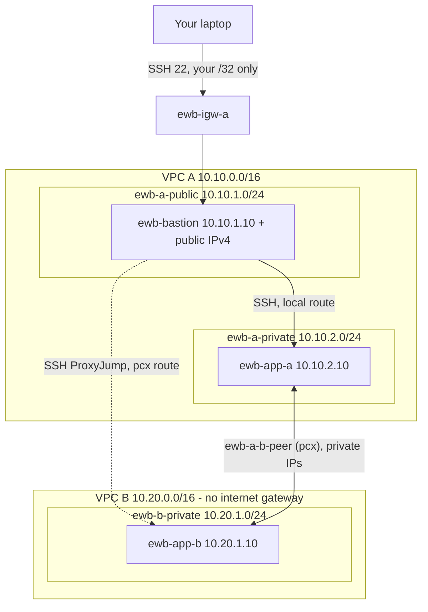

# AWS VPC Peering - EWB Cloud Labs Project 01

Two VPCs, three EC2 instances, one peering connection. Both application servers stay private; one public
bastion in VPC A is the only way in. The whole lab is built with Terraform, tested with scripts that save
real terminal output as evidence, and turned into the submission PDF by a report builder.



Details, route tables and security rules: [docs/ARCHITECTURE.md](docs/ARCHITECTURE.md).

## Verification status (please read)

The Terraform and scripts were written to the workbook line by line and the scripts were exercised against stubbed
`ssh`/`aws`/`terraform` commands, but **this code has not been applied to a real AWS account by its author**.
Before you apply, run `terraform fmt`, `terraform validate` and `terraform plan` and read the plan. The GitHub Action in
`.github/workflows/` also runs `terraform validate` on every push. The report contains **no results until you
run the lab**; every log and screenshot in it must come from your own run.

## Requirements

- AWS lab account with permission to manage VPC, EC2 and key pairs; AWS CLI configured (`aws sts get-caller-identity` works)
- Terraform 1.5 or newer
- OpenSSH client and bash (Windows: WSL), `curl`
- Python 3 with `reportlab` and `pillow` (`pip install reportlab pillow`) for the report
- Costs: EC2, EBS and public IPv4 can be charged. There is no NAT gateway. Clean up when finished.

## Step by step

```bash
export AWS_REGION=ap-south-1          # use the same Region everywhere

# 1. Key pair (the .pem is saved on your laptop only, mode 400)
scripts/create-key-pair.sh

# 2. Settings
cp terraform/terraform.tfvars.example terraform/terraform.tfvars
scripts/get-my-ip.sh                  # copy the result into my_ip_cidr; also set student_name

# 3. STAGE 1 - VPCs, subnets, routes, security groups, instances (no peering yet)
cd terraform && terraform init && terraform fmt && terraform validate && terraform plan
terraform apply && cd ..
scripts/wait-for-instances.sh         # wait for 2/2 status checks
scripts/collect-inventory.sh before
scripts/generate-ssh-config.sh --install
ssh ewb-bastion                       # verify the host key fingerprint, then: exit
ssh ewb-app-a                         # then: exit   (works before peering through the local route)
scripts/run-tests.sh baseline         # must show NO replies (Test 01)
# Take Checkpoint 01 and 02 screenshots (docs/EVIDENCE-CHECKLIST.md)

# 4. STAGE 2 - peering + three routes: set  enable_peering = true  in terraform/terraform.tfvars
cd terraform && terraform apply && cd ..
scripts/collect-inventory.sh after
ssh ewb-app-b                         # verify the host key once, then: exit
scripts/run-tests.sh after-peering    # Tests 02-05
scripts/controlled-failure.sh         # remove ICMP rule, ping fails, restore, ping works
# Take Checkpoint 03 and 04, security group and "no public IP" screenshots

# 5. Cleanup (save evidence first)
cd terraform && terraform destroy && cd ..
scripts/delete-key-pair.sh
scripts/cleanup-check.sh              # must print RESULT: PASS
# Screenshot the console filtered by the Project tag, if you like (optional)

# 6. Report
#    edit report/report_config.json (batch) and write report/learning-note.txt in your own words
python3 report/build_report.py --strict
```

The report builder writes `report/MeenapallyVishnuvardhanReddy_EWB_VPC_Peering.pdf`
(the workbook asks for `YourName_EWB_VPC_Peering.pdf`). Without `--strict` it still builds a draft and marks everything
missing as **EVIDENCE PENDING**. With `--strict` it refuses to build until every required item exists. It also refuses
to include any text that looks like a private key or AWS access key.

If you do not want to use Terraform, [docs/CONSOLE-WALKTHROUGH.md](docs/CONSOLE-WALKTHROUGH.md) has the click-by-click route.

## Where each marking area lives (100 marks)

| Assessment area | Marks | Where |
|---|---|---|
| Architecture, CIDRs and resource inventory | 15 | `docs/ARCHITECTURE.md`, `docs/architecture.png`, report section 2, `evidence/logs/00*-inventory-*.txt` |
| Subnets, internet gateway and route associations | 20 | `terraform/network.tf`, report section 3 |
| Peering plus forward and return routes | 20 | `terraform/peering.tf`, report section 4 |
| Security rules and private SSH access | 20 | `terraform/security.tf`, `scripts/generate-ssh-config.sh`, report sections 4-5 |
| Positive and negative test evidence | 15 | `scripts/run-tests.sh`, `scripts/controlled-failure.sh`, report sections 5-6 |
| Report clarity, viva and cleanup | 10 | `report/`, `docs/TROUBLESHOOTING-AND-VIVA.md`, `scripts/cleanup-check.sh` |

## Repository layout

```
terraform/   network.tf peering.tf security.tf compute.tf outputs.tf variables.tf ...
scripts/     create-key-pair, get-my-ip, generate-ssh-config, wait-for-instances, collect-inventory,
             run-tests, controlled-failure, cleanup-check, delete-key-pair
docs/        ARCHITECTURE, CONSOLE-WALKTHROUGH, TEST-PLAN, TROUBLESHOOTING-AND-VIVA, EVIDENCE-CHECKLIST
evidence/    logs/ (script output) and screenshots/ (yours)
report/      build_report.py, report_config.json, learning-note.txt, the generated PDF
```

## Design notes

- **Staged apply.** `enable_peering = false` first, so the baseline failure is real. Setting it to `true` creates the peering
  connection (auto-accepted, same account and Region) and the three routes the workbook lists.
- **Explicit everything.** Explicit route table associations, explicit egress allow-all rules (Terraform removes the default
  one), `/32` security rules, IMDSv2 required, encrypted 8 GiB gp3 root volumes with delete-on-termination.
- **Controlled failure through Terraform.** `controlled-failure.sh` removes and restores the one App-B ICMP rule with
  `app_b_icmp_enabled`, so Terraform state never drifts. Do not also edit that rule in the console.
- **No key on any instance.** The key stays on your laptop; access uses ProxyJump through the bastion.
- **Bastion IP changes** after stop/start. Re-run `scripts/generate-ssh-config.sh --install`. If your own public IP
  changes, update `my_ip_cidr` and apply again.

## Security reminders

Never commit `*.pem`, `terraform.tfvars` or state files (they are in `.gitignore`). Check every screenshot for secrets
before committing. Do not open SSH or ICMP to `0.0.0.0/0`.
