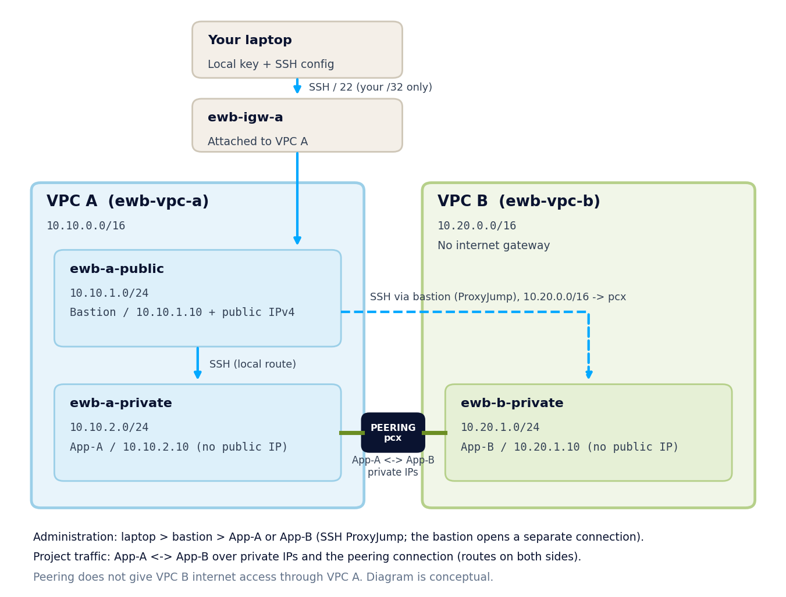

# Architecture and address plan

Regenerate the picture with `python3 docs/make_diagram.py`.

## Address plan (workbook page 4)

| Resource / Name tag | VPC or subnet | IPv4 CIDR / address |
|---|---|---|
| ewb-vpc-a | VPC A | 10.10.0.0/16 |
| ewb-a-public | VPC A / public subnet | 10.10.1.0/24 |
| ewb-a-private | VPC A / private subnet | 10.10.2.0/24 |
| ewb-vpc-b | VPC B | 10.20.0.0/16 |
| ewb-b-private | VPC B / private subnet | 10.20.1.0/24 |
| ewb-bastion | ewb-a-public | 10.10.1.10 + public IPv4 |
| ewb-app-a | ewb-a-private | 10.10.2.10, no public IP |
| ewb-app-b | ewb-b-private | 10.20.1.10, no public IP |

Other names: `ewb-igw-a`, route tables `ewb-rt-a-public`, `ewb-rt-a-private`, `ewb-rt-b-private`,
security groups `ewb-sg-bastion`, `ewb-sg-app-a`, `ewb-sg-app-b`, peering `ewb-a-b-peer`, key pair `ewb-lab`.
Every resource is tagged `Project = EWB-VPC-Peering` and `Student = <your name>`.

**Why these CIDRs?** 10.10.0.0/16 and 10.20.0.0/16 do not overlap. Peering cannot be created between
VPCs with overlapping CIDRs, and different subnet ranges inside overlapping VPCs would not fix that.

## Route tables (after peering)

| Route table (associated subnet) | Destination | Target | Purpose |
|---|---|---|---|
| ewb-rt-a-public (ewb-a-public) | 10.10.0.0/16 | local | Bastion to App-A |
| | 0.0.0.0/0 | ewb-igw-a | Bastion internet access |
| | 10.20.0.0/16 | pcx | Bastion SSH to App-B (ProxyJump) |
| ewb-rt-a-private (ewb-a-private) | 10.10.0.0/16 | local | Existing VPC A route |
| | 10.20.0.0/16 | pcx | App-A to VPC B |
| ewb-rt-b-private (ewb-b-private) | 10.20.0.0/16 | local | Existing VPC B route |
| | 10.10.0.0/16 | pcx | Return path to VPC A |

Before peering (stage 1) the private route tables contain only their local route, and the public
route table has local + 0.0.0.0/0 to the internet gateway.

## Security group inbound rules

| Security group | Type / port | Source |
|---|---|---|
| ewb-sg-bastion (VPC A) | SSH / TCP 22 | your current public IPv4 /32 |
| ewb-sg-app-a (VPC A) | SSH / TCP 22 | 10.10.1.10/32 (bastion private IP) |
| ewb-sg-app-a (VPC A) | ICMP Echo request (type 8, code 0) | 10.20.1.10/32 (App-B) |
| ewb-sg-app-b (VPC B) | SSH / TCP 22 | 10.10.1.10/32 (bastion private IP) |
| ewb-sg-app-b (VPC B) | ICMP Echo request (type 8, code 0) | 10.10.2.10/32 (App-A) |

Outbound stays at the default allow-all. Security groups are stateful, so replies to permitted
traffic are allowed automatically. Network ACLs are left at their default allow-all.

## Traffic paths

**Forward path (ping from App-A to App-B).** App-A (10.10.2.10) sends an ICMP echo request to
10.20.1.10. `ewb-rt-a-private` matches 10.20.0.0/16 and sends it to the peering connection. The packet
arrives in VPC B, and `ewb-sg-app-b` allows it because the source is 10.10.2.10/32.

**Return path.** App-B answers to 10.10.2.10. `ewb-rt-b-private` matches 10.10.0.0/16 and sends the
reply back through the peering connection. The security group is stateful, so the reply needs no extra
inbound rule on App-A. Without the route in `ewb-rt-b-private` the request would arrive but the reply
would have nowhere to go.

**Administration path.** Laptop -> internet gateway -> bastion (SSH from your /32) -> App-A over the
local route, or -> App-B over the peering route. The bastion opens a separate SSH connection, so
App-B sees the bastion private IP (10.10.1.10) as the source.
